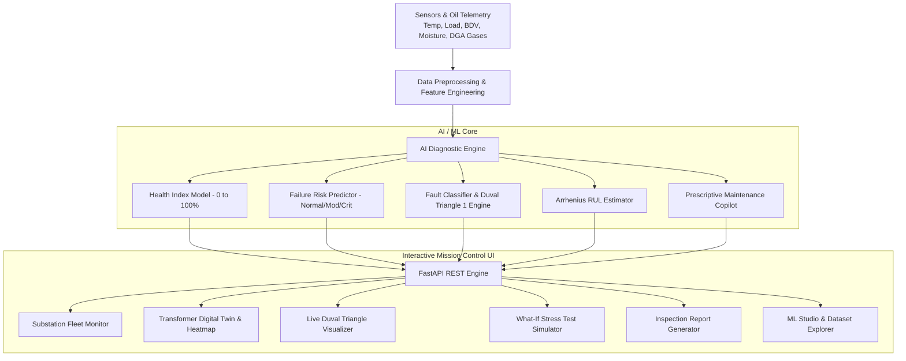

# Implementation Plan - Transformer IQ (AI-Based Transformer Health Monitoring & Predictive Maintenance System)

Transformer IQ is a comprehensive AI-powered predictive maintenance and real-time monitoring platform for power transformers in electrical distribution and transmission grids. It analyzes multi-parameter operational telemetry (temperatures, electrical loading, oil dielectric parameters, and Dissolved Gas Analysis - DGA) to compute a **Transformer Health Index (THI)**, predict failure risks before catastrophic outages occur, classify fault types using standard & AI algorithms, and provide prescriptive maintenance recommendations.

---

## User Review Required

> [!IMPORTANT]
> - The application will be structured as a **FastAPI backend with scikit-learn ML models** paired with a **cyberpunk / dark industrial SCADA-inspired web dashboard** with interactive Canvas/SVG visualizations (Duval Triangle, Transformer Thermal Twin, Live Telemetry charts, What-If Simulator, and Fleet Grid).
> - Models include:
>   1. **Transformer Health Index (THI) Regressor** (Random Forest / Gradient Boosted)
>   2. **Failure Probability & Risk Classifier** (Normal, Moderate Risk, Critical Alert)
>   3. **Fault Type Classifier** (Thermal Faults T1/T2/T3, Electrical Arcing D1/D2, Partial Discharge PD, Cellulose Degradation)
>   4. **Duval Triangle 1 & IEC 60599 DGA Diagnostic Engine**
>   5. **Arrhenius Remaining Useful Life (RUL) Estimator**

---

## Proposed System Architecture

---

## Proposed Changes

### 1. Dataset Generation & ML Modeling Pipeline

#### [NEW] [generate_dataset.py](file:///e:/Transformer%20IQ/backend/generate_dataset.py)
- Synthesizes 1,500+ realistic transformer inspection records based on IEEE C57.104 (DGA standards), IEEE C57.91 (Thermal loading guide), IEC 60599, and Arrhenius thermal aging physics.
- Features: Top Oil Temp (°C), Winding Hotspot Temp (°C), Ambient Temp (°C), Load Factor (%), Voltage (kV), Current (A), BDV (Breakdown Voltage kV), Moisture in Oil (ppm), Acidity (mg KOH/g), Interfacial Tension (mN/m), DGA Gases ($H_2, CH_4, C_2H_2, C_2H_4, C_2H_6, CO, CO_2$), $CO_2/CO$ ratio, TDCG.
- Labels: Health Index (0-100), Failure Risk Category (Normal, Warning, Critical), Fault Diagnosis (Normal, PD, T1, T2, T3, D1, D2, Cellulose Degradation), Remaining Useful Life (months).

#### [NEW] [train_models.py](file:///e:/Transformer%20IQ/backend/train_models.py)
- Trains, evaluates, and serializes:
  1. `transformer_hi_model.joblib`: Random Forest Regressor for Health Index (R² > 0.95).
  2. `transformer_fault_model.joblib`: Random Forest Classifier for specific fault typology.
  3. `scaler.joblib`: Feature scaler for telemetry normalization.
- Generates model performance metrics (Confusion Matrix, Feature Importances, ROC-AUC, MAE, R²).

#### [NEW] [dga_engine.py](file:///e:/Transformer%20IQ/backend/dga_engine.py)
- IEEE C57.104 Condition 1-4 evaluation.
- Duval Triangle 1 coordinate calculations:
  $$\%CH_4 = \frac{CH_4}{CH_4 + C_2H_4 + C_2H_2} \times 100$$
  $$\%C_2H_4 = \frac{C_2H_4}{CH_4 + C_2H_4 + C_2H_2} \times 100$$
  $$\%C_2H_2 = \frac{C_2H_2}{CH_4 + C_2H_4 + C_2H_2} \times 100$$
- Polygon point-in-triangle classification for PD, T1, T2, T3, D1, D2, DT.
- Rogers Ratios and IEC 60599 validation.

---

### 2. Backend REST API (FastAPI)

#### [NEW] [main.py](file:///e:/Transformer%20IQ/backend/main.py)
- FastAPI application serving:
  - `GET /api/fleet`: Overview of 6 diverse transformers across different substations (Healthy, Overheated, Moisture ingress, Arcing alert, Aging, etc.).
  - `GET /api/transformer/{id}`: Detailed telemetry, timeseries history, current readings.
  - `POST /api/predict`: Real-time inference on custom/simulated telemetry input.
  - `POST /api/simulate`: Real-time what-if parameter stress testing.
  - `GET /api/model/metrics`: Model evaluation data, feature importance, confusion matrix.
  - `GET /api/dataset`: Sample dataset records and distributions.
  - Static file mounting for serving the web interface.

---

### 3. Rich Industrial SCADA & Mission Control Frontend

#### [NEW] [index.html](file:///e:/Transformer%20IQ/frontend/index.html)
- Responsive, modern layout with top navigation:
  - **Fleet Overview**: Grid cards with live pulsating status rings, Health Index radial dials, alert tags.
  - **Transformer Deep Dive & Digital Twin**: SVG/Canvas schematic of a power transformer with dynamic heatmaps, cooling fan status, core/windings hotspots, oil level indicator.
  - **Live Telemetry & Diagnostics**: Real-time multi-metric sparklines and charts for temperatures, electrical loads, and oil moisture.
  - **Duval Triangle 1 Visualizer**: Interactive ternary plot canvas mapping the exact point within standard fault zones (PD, T1, T2, T3, D1, D2) with live cursor tracking.
  - **What-If Scenario Simulator**: Interactive sliders (Load %, Ambient Temp, Arcing Gas Surge, Moisture Ingress) with instant AI prediction updates.
  - **Prescriptive Maintenance Copilot**: Step-by-step actionable recommendations (e.g. vacuum dehydration, oil filtration, fan bank maintenance, emergency de-energization).
  - **AI Model Performance & Dataset Studio**: Feature importance bar charts, confusion matrix visualization, metrics summary, and raw data explorer.
  - **Export Inspection Report**: Printable modal with complete diagnostic summary and printable layout.

#### [NEW] [styles.css](file:///e:/Transformer%20IQ/frontend/styles.css)
- Custom dark cyberpunk / futuristic industrial SCADA UI with glowing neon accents (cyan `#00f2fe`, amber `#f59e0b`, emerald `#10b981`, rose `#f43f5e`), glassmorphism cards, animated gauges, responsive grid.

#### [NEW] [app.js](file:///e:/Transformer%20IQ/frontend/app.js)
- High-performance vanilla JavaScript application handling:
  - Real-time simulation clock and live telemetry jitter animation.
  - Duval triangle canvas rendering and coordinate projection.
  - Digital twin hotspot rendering.
  - Chart.js / custom canvas telemetry line and bar charts.
  - What-If slider live bindings to the AI backend.
  - Quick scenario presets (Normal Run, Heavy Summer Peak, Dielectric Breakdown, High-Energy Arcing Fault, Overheated Core).

---

## Verification Plan

### Automated Verification
1. Run `python backend/generate_dataset.py` to create the dataset `data/transformer_dataset.csv`.
2. Run `python backend/train_models.py` to train the AI models and verify high accuracy ($R^2 > 0.90$, Classification Accuracy $> 95\%$).
3. Run `python backend/dga_engine.py` unit tests to ensure Duval Triangle coordinates and fault classifications match IEEE/IEC standards.
4. Launch FastAPI server `uvicorn backend.main:app --port 8000` and test all API endpoints (`/api/fleet`, `/api/predict`, `/api/simulate`, `/api/model/metrics`).

### Interactive Verification
1. Open the web UI in the browser.
2. Verify all tabs:
   - Fleet view with multi-transformer health statuses.
   - Digital Twin showing animated transformer hotspot temperatures and oil flow.
   - Duval Triangle canvas correctly plotting gas coordinates.
   - What-If simulation slider updates updating AI Health Index and Risk % in real-time.
   - Model Metrics tab displaying SHAP-like feature importances.
   - Report export modal generates clean printable format.
